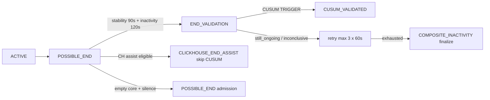

# TDL CUSUM Finalization — Fable Architecture Review Package V1

| Field | Value |
|-------|-------|
| **Operation** | `TDL_CUSUM_FINALIZATION_REPLAY_EVIDENCE_V1` |
| **Review type** | Architecture / algorithm — **no activation requested** |
| **Production SHA** | `a27ca9059b9fa9e8aa88696e811107fb427cb369` |
| **Scope** | Trip end FSM, `detectTripEndChangePoint`, CH end assist, provider silence admission, COMPOSITE_INACTIVITY fallback |

## 1) Problem statement

Fleet finalize latency (canonical `end_time` → `endRecognizedAt`) is dominated by POSSIBLE_END dwell and CUSUM END_VALIDATION retry exhaustion, not post-finalize enrichment (~7s p50). CUSUM is **trusted on 12/207** completed trips; **117/207** use max-attempt **COMPOSITE_INACTIVITY** fallback. Sample-index CUSUM confirmation misaligns with irregular RUPTELA sampling and provider silence after stop.

**Evidence:** [`TDL_FINALIZATION_CUSUM_FORENSIC_AUDIT_V1`](/opt/cursor/artifacts/tdl-finalization-cusum-forensic-audit-report.md) (read-only production).

## 2) Architecture baseline (frozen for review)

Code anchors: `trip-cusum.ts`, `change-point-end.detector.ts`, `trip-detection-orchestration.service.ts` (`processPossibleEndCheck`, `processEndValidation`), `worker.config.ts` defaults.

## 3) Optimization options under review

| ID | Option | Intent | Replay signal (offline) |
|----|--------|--------|------------------------|
| **A** | FSM scheduling / retry budget | Reduce quantised dwell + retry wall-clock | ~115s faster on composite/Tesla inconclusive fixtures |
| **B** | Time-aware CUSUM | Wall-clock confirmation vs sample index | Mixed — regression on dense-stop fixture; tie on silence fixture |
| **C** | CH assist + provider silence | Skip CUSUM when alternate stop proof | **~225s** modeled savings on CH fixture; **~120s** on silence fixture vs baseline composite |

## 4) Independent review questions (Fable)

1. **Sample-index confirmation** — Is `minConfirmationPoints=3` scientifically valid when inter-sample gaps exceed 60–120s on RUPTELA? What false-negative rate is acceptable vs COMPOSITE fallback?

2. **Null speed as stopped** — Treating `speed == null` as stopped inflates stopped fraction under telemetry silence. Should silence be a separate evidence channel rather than CUSUM input?

3. **COMPOSITE_INACTIVITY fallback** — After three inconclusive CUSUM cycles, is composite finalize **semantically equivalent** to “stop proven” for DI/DS4 admission, or should admission remain gated?

4. **Candidate A** — Is reducing retry budget without CH/silence forensics **unsafe** for stop-and-go urban driving (Tesla `still_active_at_window_end` class)?

5. **Candidate B** — Proposed time-weighted CUSUM + 90s stopped-span gate: specify minimum evidence for production promotion. Replay showed **regression** on dense-stop exemplar — is dual-threshold (provider-class aware) required?

6. **Candidate C (CH)** — Arteon fleet **85%** CH_ASSIST with ~194s p50: what resume-invalidation and segment-end wrong-side tests are mandatory before RUPTELA allowlist expansion?

7. **Candidate C (silence)** — `provider_silence_empty_core_admission` (trip `858dcef6…`): can fast finalize be **safe** without mid-gap split conflation? Interaction with `MID_TRIP_GAP_SPLIT`?

8. **Boundary revision** — CUSUM_VALIDATED with `endRecognizedAt < end_time` (`b304e9ad…`): should replay success metrics use movement anchor vs canonical end?

9. **Observability** — Should `endValidation.startedAt/completedAt` be persisted on **all** finalize paths (including max-attempt fallback) before latency tuning?

10. **DS4 coupling** — Finalize lag dominates S4 `eligible_at` (p50 ~126s after finalize). Is trip-end optimization **P0** for DS4 fleet readiness vs admission worker tuning?

## 5) Required validation gates (pre-implementation)

| Gate | Command / artifact |
|------|-------------------|
| Offline replay | `cd backend && npx ts-node --transpile-only scripts/research/tdl-cusum-finalization-replay-v1.harness.ts` |
| Postgres integration | `trip-r12-cusum-ongoing-boundary-retry.postgres-redis.integration.spec.ts` |
| CH resume | `trip-r12-ch-assist-resume-invalidation.postgres-redis.integration.spec.ts` |
| Provider silence | `trip-r12-provider-silence-cusum-retry-budget.postgres-redis.integration.spec.ts` |
| Registry | `bash architecture/scripts/validate-module-registry.sh` |

## 6) Proposed decision posture (for reviewers)

| Option | Suggested status | Condition |
|--------|------------------|-----------|
| A | PROPOSED | Only with silence/CH gating |
| B | EXPERIMENTAL | Fable PASS required; no prod change in first PR |
| C (CH) | PROPOSED | RUPTELA allowlist + existing R12 specs green |
| C (silence) | EXPERIMENTAL | Requires gap-split safety proof + Fable sign-off |

## 7) Evidence index

- Forensic audit: `/opt/cursor/artifacts/tdl-finalization-cusum-forensic-audit-report.md`
- Replay JSON/CSV: `/opt/cursor/artifacts/tdl-cusum-replay-evidence-v1.json`
- Fixtures: `TDL_CUSUM_REPLAY_FIXTURES_V1/manifest.json`
- This package + replay memo: `TDL_CUSUM_FINALIZATION_REPLAY_EVIDENCE_V1.md`

**FABLE_REVIEW=REQUESTED** — no production mutations, activation, or deployment authorized by this package.
